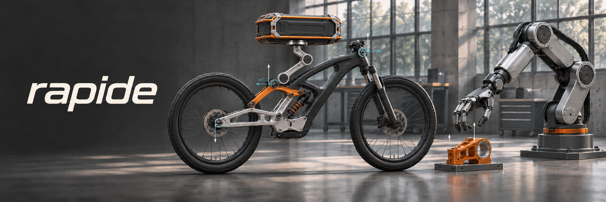

<p align="center">
  
</p>

<p align="center">
  <strong>Multibody physics for autonomous wheeled vehicles, in modern C++.</strong>
</p>

<p align="center">
  
  
  
  
</p>

## Overview

**rapide** is a rigid multibody simulator built for wheeled robots and vehicles: chassis,
suspension linkages, wheels and compliant tires. One authored model runs on two interchangeable
backends:

- **[Maximal coordinates](rapide/maximal/README.md).** Every body carries a full pose. Joints are analytic bilateral
  constraints solved with a dense, rank-aware impulse solve, so closed loops and redundant
  constraints (four-bars, rockers, parallel linkages) need no tree-cutting.
- **Articulated Body Algorithm (ABA).** A scalar-templated, reduced-coordinate backend for tree
  models, kept for speed comparisons and future autodiff.

Both backends share the same `Model`, the same COM body-state representation, and the same force
interface, so tires, springs, actuators and recording work unchanged on either.

### Features

- Ball, fixed, revolute and prismatic joints in arbitrary graphs, including kinematic loops
- Mass-weighted position/velocity projection with numerical-rank and residual diagnostics
- Point spring-dampers, scalar joint springs, and torque/force actuation
- Compliant elliptic-torus tire with independent longitudinal/lateral slip and a friction circle
- [Coal](https://github.com/coal-library/coal) broad phase, collision filtering and compliant contact with sliding friction
- Recording export and browser playback through [Meshcat](https://github.com/meshcat-dev/meshcat), including tire deformation

## Quick look

A bike with a sprung rear rocker, on deformable tires, dropped 15 cm onto the ground (condensed from [`examples/models/bike.hpp`](examples/models/bike.hpp)):

```cpp
#include "rapide/contact/compliant_tire.hpp"
#include "rapide/simulator.hpp"
#include <iostream>
#include <numbers>

using namespace rapide;

ModelBuilder builder;  // Body 0 is the static world.
const auto axle = rotation_increment(Vec3{-std::numbers::pi / 2, 0, 0});  // Hinges spin about Y.

auto frame  = builder.add_body("frame",  30, Vec3{1, 4, 4}.asDiagonal(),        {{0, 0, .80}});
auto rocker = builder.add_body("rocker",  2, Vec3{.03, .15, .15}.asDiagonal(),  {{-.2, 0, .63}});
auto rear   = builder.add_body("rear",    3, Vec3{.09, .18, .09}.asDiagonal(),  {{-.65, 0, .48}});
auto front  = builder.add_body("front",   3, Vec3{.09, .18, .09}.asDiagonal(),  {{.65, 0, .48}});

// Rear suspension: frame -> rocker -> wheel. The front wheel sits on a rigid fork.
auto pivot = builder.add_joint(JointType::Revolute, frame,  rocker, {{-.2, 0, -.17}, axle}, {Vec3::Zero(), axle});
builder.add_joint(JointType::Revolute, rocker, rear,  {{-.45, 0, -.15}, axle}, {Vec3::Zero(), axle});
builder.add_joint(JointType::Revolute, frame,  front, {{.65, 0, -.32}, axle},  {Vec3::Zero(), axle});

// Coil-over between a frame bracket and the rocker's spring arm (5 kN/m, 150 N s/m).
LinearSpring shock{frame, rocker, {.05, 0, -.42}, {.25, 0, .3}, 5000, 150, .61};
Tire tire;  // Elliptic torus: normal spring-damper, slip stiffness, friction circle.
tire.stiffness = 10000;
tire.damping = 200;

Simulator sim(builder.build());  // Backend::Maximal by default; gravity is -Z.
sim.set_force_callback([&](const Model &model, const State &state) {
  auto forces = zero_forces(model);
  for (auto wheel : {rear, front}) {
    forces[wheel] = tire.compute(state.bodies[wheel]).wrench;
  }
  add_spring(model, state, forces, shock);
  return forces;
});

while (sim.time() < 3.0) {
  sim.step(1e-3);  // Returns a report: constraint rank, residuals, impulses.
}
// Lands, compresses the shock, bounces, and settles ~15 cm lower.
std::cout << "frame height " << sim.state().bodies[frame].pose.position.z()
          << " m, rocker angle " << joint_position(sim.model(), sim.state(), pivot) << " rad\n";
```

Bodies are independent of joints: add all bodies, then connect any pair. A closed loop, like the
[four-bar linkage](docs/examples.md#four-bar-linkage-closed-loop), is just one more
`add_joint`.

[`docs/design.md`](docs/design.md) covers the model conventions, the two backends, the solver and
collision.

## Getting started

**Prerequisites:** a C++20 compiler, CMake 3.23+, Ninja and Python 3. Native dependencies
(Eigen 3.4, Coal 3.0, Catch2 3.8) are pinned in `conan.lock` and installed by Conan 2.

```bash
git clone git@github.com:NickG-NZ/rapide.git
cd rapide

python3 -m venv .venv && source .venv/bin/activate
python -m pip install -r tools/requirements-build.txt
conan profile detect

conan install . -pr:h=conan/profiles/release -pr:b=default --build=missing
cmake --preset conan-release
cmake --build --preset conan-release -j 2
ctest --preset conan-release --output-on-failure
```

The first `conan install` can take several minutes. Debug builds, build options and lockfile
updates are covered in [`docs/development.md`](docs/development.md).

**Run a rollout and watch it.** Drop a two-wheel bike with rear suspension onto the ground, then
open the recording in the browser:

```bash
python3 -m venv tools/viewer/.venv
tools/viewer/.venv/bin/python -m pip install -r tools/viewer/requirements.txt

./build/Release/bike_rollout --record /tmp/bike.json > /tmp/bike.csv
tools/viewer/.venv/bin/python tools/viewer/view_recording.py \
  --recording /tmp/bike.json --html /tmp/bike.html --open
```

`four_bar_rollout` and `wheel_rollout` record the same way; `motorcycle_rollout` (ABA backend)
writes CSV only. See [`docs/examples.md`](docs/examples.md) for what each one demonstrates and what its CSV
contains.

## Development

```bash
ctest --preset conan-release --output-on-failure        # C++ tests

# Format (clang-format 15+, requires ripgrep)
rg --files -0 rapide examples test -g '*.hpp' -g '*.cpp' | xargs -0 clang-format -i
```

Viewer integration tests and other workflow details are in
[`docs/development.md`](docs/development.md) and [`docs/examples.md`](docs/examples.md).
