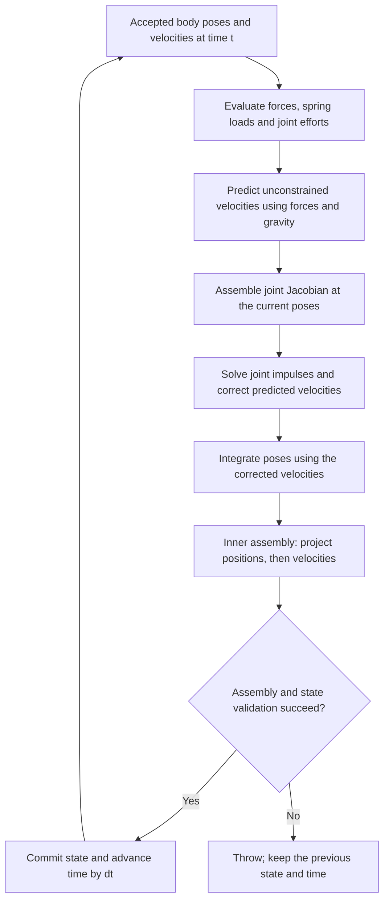
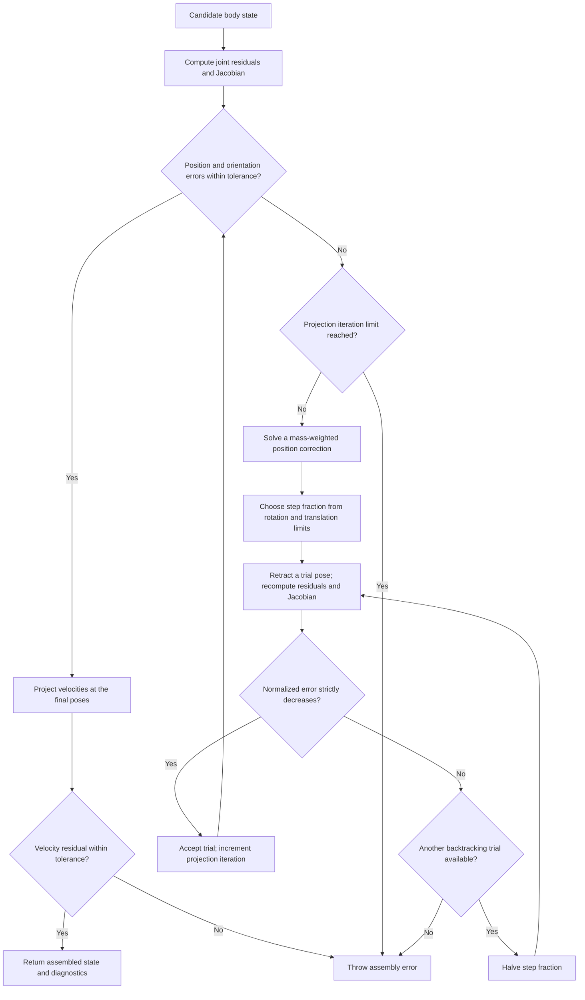
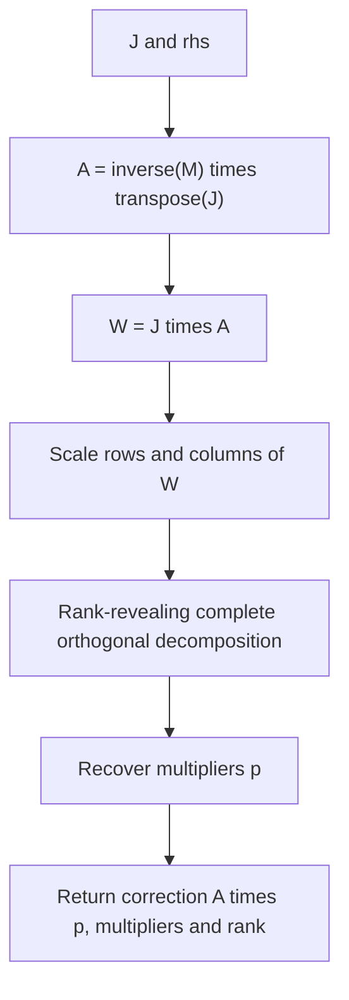

# Maximal-coordinate solver

Rapide's maximal backend advances independent rigid bodies and uses bilateral joint
constraints to keep their motion compatible. Every dynamic body retains six velocity
components, even when joints remove most of its freedom. Closing a linkage adds joint
rows to the same system; it does not require cutting the loop into a tree.

This document describes the implementation in [backend.hpp](backend.hpp),
[constraints.hpp](constraints.hpp), and [state.hpp](state.hpp). Read the loop diagrams
first, then the mathematical derivation below.

## 1. The loops

There are three levels of repetition:

| Level | What repeats | What changes |
|---|---|---|
| Outer simulation loop | `Simulator::step(dt)` | Physical time and the accepted state |
| Inner position-projection loop | `MaximalBackend::assemble` | A candidate configuration, at the same physical time |
| Backtracking loop | Up to 16 trials per position correction | The fraction of that correction to apply |

Each constraint linear system is solved by a **dense direct decomposition**. There
is no iterative per-joint impulse sweep, contact active-set loop, or complementarity
solve inside it.

### Outer loop: one physical timestep

`Simulator::step(dt)` evaluates its force callback once and adds persistent joint
efforts and springs. `step(dt, forces)` instead uses exactly the supplied force array.
The backend holds these loads constant throughout the step; position projection does
not reevaluate springs or tires. Gravity is applied separately by the backend.

The first velocity solve makes the predicted motion compatible with the joints at
the **old poses**. Integrating that motion generally introduces a small nonlinear
position error. Assembly corrects that error and makes the final velocity compatible
with the **new poses**.

### Inner loop: assemble a joint-consistent state

This routine runs both after pose integration and when setting an initial state.
Physical time does not advance within it.

Every backtracking trial starts from the current accepted projection iterate; rejected
trials do not accumulate pose changes. The next projection iteration recomputes the
correction using the accepted trial's Jacobian. The final velocity projection is one
linear solve, followed by a residual check.

### The linear solve shared by all three corrections

The same `solve(J, rhs)` routine handles the timestep impulse, each position
correction, and the final velocity projection. Only the Jacobian and right-hand side
change.

## 2. State and coordinate conventions

For each dynamic body $i$, the public state stores:

| Symbol | Meaning | Coordinates |
|---|---|---|
| $x_i$ | Center-of-mass position | World |
| $q_i$, $R_i$ | Unit quaternion and corresponding rotation | Body to world |
| $\omega_i$ | Angular velocity relative to the world | Body |
| $v_i$ | Center-of-mass linear velocity | World |
| $I_i$ | Inertia about the center of mass | Body |
| $f_i$, $\tau_i$ | Applied force and torque about the center of mass | World |

The packed velocity vector is

$$
u = [\omega_1^T, v_1^T, \ldots, \omega_N^T, v_N^T]^T
\in \mathbb{R}^{6N}.
$$

A pose correction has the matching order
$\delta=[\delta\theta_1^T,\delta x_1^T,\ldots]^T$, with body-frame rotation
increments and world-frame translations. Quaternions store orientation, but the
linear solver operates on three-component rotation increments, not four quaternion
coefficients.

The mass matrix in these coordinates is

$$
M=\operatorname{blockdiag}(I_1,m_1\mathbf{1}_3,\ldots,I_N,m_N\mathbf{1}_3).
$$

Mixed frames are valid because **every Jacobian column and mass block uses the same
convention as its corresponding velocity component**. The angular momentum load is
therefore body-expressed while the linear momentum load is world-expressed.

Static bodies contribute attachment poses to the constraints but have no velocity
columns or mass blocks. Their poses are fixed. The implementation applies $M^{-1}$
block by block; it does not build or invert a dense global mass matrix.

## 3. Joint residuals and analytic Jacobians

Stack the joint errors into $\phi(x,q)$. A valid configuration satisfies

$$
\phi(x,q)=0, \qquad \dot\phi=Ju=0.
$$

Here $J$ is the derivative with respect to the six-component body pose increments:

$$
\phi(\operatorname{retract}(x,q,\delta))
=\phi(x,q)+J\delta+O(\|\delta\|^2).
$$

The code computes these derivatives analytically. No autodiff is used. The same
Jacobian relates velocities to the time derivative of the joint errors.

### Attachment frames

For a joint between bodies $a$ and $b$, let $s_a,s_b$ be the attachment positions in
each authored body frame, and $c_a,c_b$ the authored-origin-to-COM offsets. Define

$$
r_a=R_a(s_a-c_a),\qquad r_b=R_b(s_b-c_b),
$$

$$
d=(x_b+r_b)-(x_a+r_a).
$$

If $F_a,F_b$ are the attachment rotations relative to each body, their world
orientations are $Q_a=R_aF_a$ and $Q_b=R_bF_b$. Define the relative rotation vector

$$
e=\operatorname{Log}(Q_a^TQ_b).
$$

`Log` is the principal SO(3) logarithm, represented as a three-component axis-angle
vector. Joint axes are the attachment frames' local Z axes.

| Joint | Translation residual | Rotation residual | Rows |
|---|---|---|---:|
| Ball | $d$ | None | 3 |
| Fixed | $d$ | $e$ | 6 |
| Revolute | $d$ | $e_x,e_y$ | 5 |
| Prismatic | $(Q_a^Td)_x,(Q_a^Td)_y$ | $e$ | 5 |

A revolute joint permits relative rotation about local Z. A prismatic joint permits
translation along local Z. A floating body needs no joint rows.

### Example: attachment-position Jacobian

Write $[r]_\times z=r\times z$. The two body blocks for the residual $d$ are

$$
J_{d,a}=\begin{bmatrix}[r_a]_\times R_a&-\mathbf{1}_3\end{bmatrix},
\qquad
J_{d,b}=\begin{bmatrix}-[r_b]_\times R_b&\mathbf{1}_3\end{bmatrix}.
$$

These signs follow from the attachment velocity
$v_i+(R_i\omega_i)\times r_i$. For a prismatic joint, let $T=Q_a^T$. The full
three-row derivative before selecting its first two rows is

$$
J_{p,a}=\begin{bmatrix}T([r_a]_\times+[d]_\times)R_a&-T\end{bmatrix},
\qquad
J_{p,b}=\begin{bmatrix}-T[r_b]_\times R_b&T\end{bmatrix}.
$$

The extra $[d]_\times$ term accounts for the rotation of the coordinate frame in
which the sliding displacement is measured.

### Orientation Jacobian

Let $L^{-1}(e)$ denote the inverse left Jacobian of SO(3). Then

$$
\dot e=L^{-1}(e)Q_a^T(R_b\omega_b-R_a\omega_a).
$$

Thus the rotational blocks are $-L^{-1}(e)Q_a^TR_a$ and
$L^{-1}(e)Q_a^TR_b$, with zero linear-velocity blocks. Revolute joints retain only
the first two rows. [rotation.hpp](../math/rotation.hpp) implements

$$
L^{-1}(e)=\mathbf{1}_3-\tfrac12[e]_\times+
\frac{1-\tfrac12\theta\cot(\theta/2)}{\theta^2}[e]_\times^2,
\qquad \theta=\|e\|,
$$

using a series for the coefficient near zero. The principal-log chart is
discontinuous at a relative angle of $\pi$; initialization near that boundary can
be difficult even for a physically valid hinge.

## 4. Predict unconstrained velocities

With timestep $h$, the backend first ignores joint reactions and computes

$$
\dot\omega_i=I_i^{-1}\left(R_i^T\tau_i-
\omega_i\times(I_i\omega_i)\right),\qquad
\dot v_i=g+\frac{f_i}{m_i}.
$$

The cross product is the gyroscopic term in body coordinates. The predicted
velocities are

$$
\omega_i^*=\omega_i+h\dot\omega_i,\qquad
v_i^*=v_i+h\dot v_i.
$$

Stack these into $u^*$. Forces are evaluated from the start-of-step state. There is
no implicit spring-force iteration, so stiff springs and penalty contacts still
require an appropriately small timestep.

## 5. Solve joint impulses

At the current configuration, seek the smallest mass-weighted change to $u^*$ that
satisfies the velocity constraints:

$$
\min_{\Delta u}\ \frac12\Delta u^TM\Delta u
\quad\text{subject to}\quad J(u^*+\Delta u)=0.
$$

Using a multiplier $p$ with the sign convention
$M\Delta u=J^Tp$ gives

$$
W p=-Ju^*,\qquad W=JM^{-1}J^T,
$$

$$
\Delta u=M^{-1}J^Tp,\qquad u^+=u^*+\Delta u.
$$

$J^Tp$ is the generalized body impulse. The multiplier components correspond to
the joint rows, so their units depend on whether the row constrains translation or
rotation. They can have either sign: these are bilateral constraints.

This velocity-level method does not explicitly form $\dot J u$ or solve an
acceleration-level constrained system. Its later position projection handles the
nonlinear drift left by the finite timestep.

### Scaling and dependent constraints

The implementation forms $A=M^{-1}J^T$ and the dense constraint-space matrix $W=JA$.
It scales with

$$
D_{ii}=\begin{cases}1/\sqrt{W_{ii}},&W_{ii}>0,\\1,&W_{ii}=0.\end{cases}
$$

For a generic right-hand side $b$, it uses Eigen's
`CompleteOrthogonalDecomposition` to solve

$$
(DWD)y=Db,\qquad p=Dy,\qquad \delta=Ap.
$$

The decomposition uses the configured numerical-rank threshold. It returns a
least-squares solution when necessary and handles rank deficiency without explicitly
deleting joint rows. For consistent constraints, the resulting body correction is
the unique minimum-$M$-norm correction, even when the individual multipliers are
not unique. With incompatible rows, the scaled least-squares result can leave
residuals; assembly must still pass its convergence checks.

For example, the [four-bar linkage](../../examples/models/four_bar.hpp) has three
dynamic bodies (18 velocity components) and four revolute joints (20 rows). At its
regular configurations the Jacobian has rank 17, leaving one instantaneous degree
of freedom. The three redundant rows are handled by the decomposition. Singular
configurations can change the rank.

## 6. Integrate poses

Use $u^+$ to advance each COM and orientation:

$$
x_i'=x_i+h v_i^+,\qquad
q_i'=\operatorname{normalize}\left(q_i\otimes
\operatorname{Exp}_q(h\omega_i^+)\right).
$$

For a rotation vector $\theta$, the increment quaternion is

$$
\operatorname{Exp}_q(\theta)=
\left(\cos\frac{\|\theta\|}{2},\;
\frac{\sin(\|\theta\|/2)}{\|\theta\|}\theta\right),
$$

written here as scalar then vector, with a small-angle branch in the code.
Right multiplication is required because the increment is body-expressed.
This is a velocity-first, semi-implicit Euler step with an exponential orientation
update; it is not a higher-order integration method.

## 7. Project positions: the nonlinear inner loop

After integration, generally $\phi(x',q')\ne0$. At each projection iterate, solve

$$
\min_\delta\ \frac12\delta^TM\delta
\quad\text{subject to}\quad J\delta=-\phi.
$$

The same linear solver now uses $b=-\phi$. Its multipliers are position-correction
quantities, not physical impulses. The method repeats a locally linearized
minimum-change solve; it does **not** solve a global closest-configuration problem.

### Retraction and backtracking

For a candidate step fraction $\alpha$, apply

$$
x_i^{\mathrm{trial}}=x_i+\alpha\delta x_i,\qquad
q_i^{\mathrm{trial}}=\operatorname{normalize}\left(
q_i\otimes\operatorname{Exp}_q(\alpha\delta\theta_i)\right).
$$

The initial fraction is the minimum of 1 and the per-body rotation/translation
limits divided by the corresponding correction norms; zero norms impose no limit.
The acceptance measure is

$$
E(\phi)=\max\left(
\frac{\|\phi_{\mathrm{linear}}\|_\infty}{\varepsilon_x},
\frac{\|\phi_{\mathrm{angular}}\|_\infty}{\varepsilon_\theta}
\right).
$$

Empty row groups contribute zero. Accept only if $E$ strictly decreases. Otherwise
halve $\alpha$ and retry, up to 16 trials. Position projection finishes when
$E\le1$, or throws if it stalls or exceeds its iteration limit.

During each accepted orientation correction, the body-frame angular velocity is
also transported:

$$
\omega_i^{\mathrm{trial}}=
\operatorname{Exp}(\alpha\delta\theta_i)^T\omega_i.
$$

This preserves the existing **world** angular velocity while changing the pose:
$R_i^{\mathrm{trial}}\omega_i^{\mathrm{trial}}=R_i\omega_i$. It prevents a numerical
pose correction from accidentally rotating the physical angular-velocity vector.
The later velocity projection may then change that vector to satisfy the joints.

### Final velocity projection

At the converged configuration, repack the transported velocities as $\tilde u$ and
solve once more:

$$
W p_v=-J\tilde u,\qquad
u_{n+1}=\tilde u+M^{-1}J^Tp_v.
$$

Require $\|Ju_{n+1}\|_\infty\le\varepsilon_v$. This single tolerance is applied
numerically to all velocity rows, which mix translational and angular units.
Only after this check and state validation does the backend commit the step.

## 8. Initialization, diagnostics, and limits

Construction assembles `model.initial_state`. `sim.set_state(state)` uses the same
position and velocity projection, without advancing or resetting time. Supply a
reasonable geometric guess; the routine finds joint compatibility, not force
balance. It does not find suspension sag or a static tire/contact equilibrium.
The original `model.initial_state` remains the authored guess; `sim.state()` is the
accepted, assembled state. Failed state assignments and steps preserve the previous
accepted simulator state.

Default settings in [SolverOptions](../backend.hpp):

| Setting | Default | Meaning |
|---|---:|---|
| `position_tolerance` | $10^{-9}$ m | Maximum absolute linear residual component |
| `orientation_tolerance` | $10^{-9}$ rad | Maximum absolute angular residual component |
| `velocity_tolerance` | $10^{-8}$ | Maximum absolute component of $Ju$ |
| `rank_threshold` | $10^{-10}$ | Relative rank threshold for the scaled decomposition |
| `max_translation_correction` | 0.1 m | Per-body cap used to choose the initial trial fraction |
| `max_rotation_correction` | 0.25 rad | Per-body cap used to choose the initial trial fraction |
| `max_projection_iterations` | 30 | Maximum accepted position-correction iterations |

`StepReport` records:

- `constraint_rows` and `rank`: row count and numerical rank at the final configuration.
- `projection_iterations`: accepted position corrections, excluding rejected trials.
- `position_error`, `orientation_error`, `velocity_error`: final maximum-component residuals.
- `constraint_impulses`: multipliers from the pre-integration velocity solve.
- `projection_impulses`: multipliers from the final velocity projection, **not** the position corrections.

Dividing `constraint_impulses` by the timestep gives a timestep-averaged joint
reaction estimate in the chosen row coordinates. Individual reactions are not
uniquely determined for redundant constraints. Projection multipliers describe
numerical corrections and should not be interpreted as physical contact forces.

The current solver is first order and is not energy-conserving. It handles bilateral
joints; tires and compliant collisions supply external forces rather than unilateral
constraint rows. There is no hard-contact nonpenetration, joint-limit, or Coulomb
friction complementarity solve here. Dense Jacobians, constraint matrices, and
factorizations are rebuilt and allocated during solves. Preallocation, sparse
structure, and performance benchmarking remain future work.

## Code map

| File/function | Responsibility |
|---|---|
| [Simulator::step](../simulator.hpp) | Force assembly, backend dispatch, time advancement |
| [MaximalBackend::advance](backend.hpp) | Velocity prediction, joint impulses, pose integration, assembly |
| [MaximalBackend::assemble](backend.hpp) | Nonlinear position projection and final velocity projection |
| [MaximalBackend::solve](backend.hpp) | Scaled, rank-aware constraint-space solve |
| [assemble_constraints](constraints.hpp) | Joint residuals and analytic Jacobians |
| [retract](state.hpp) | Pose increments and angular-velocity transport |
| [Shared integration helpers](../integration/configuration.hpp) | Linear and quaternion updates |
| [Maximal tests](../../test/test_maximal.cpp) | Loop closure, redundant constraints, Jacobians, projection, and failure behavior |
